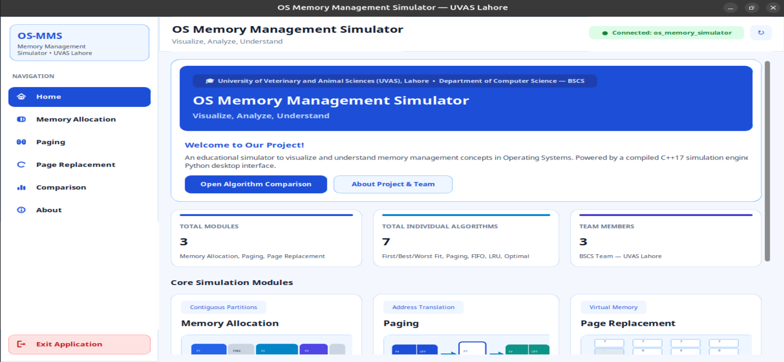
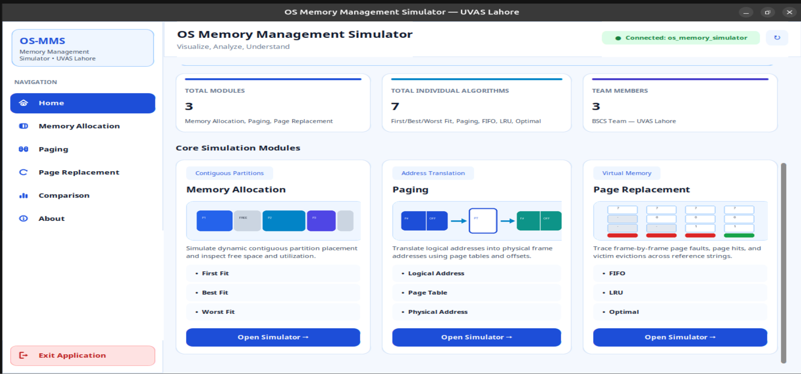
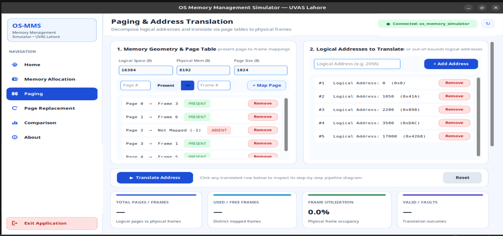
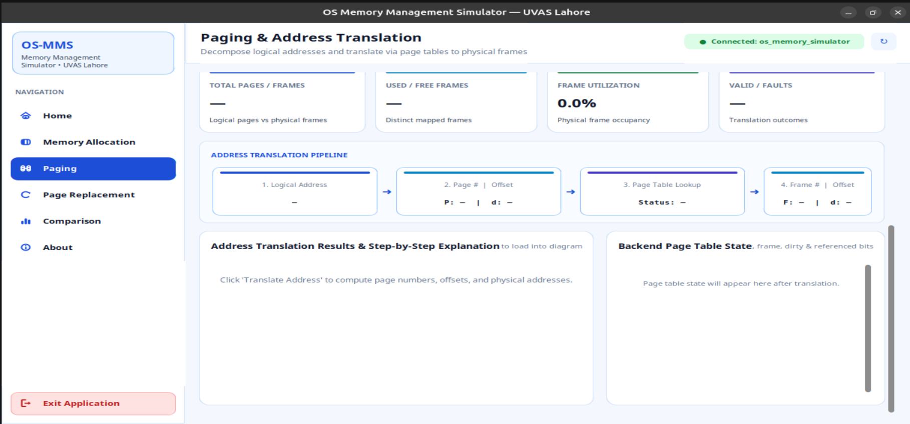
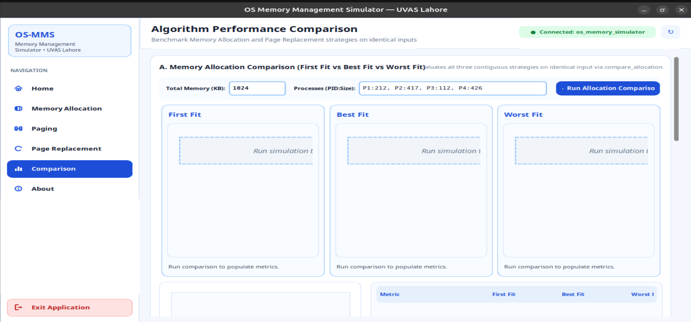
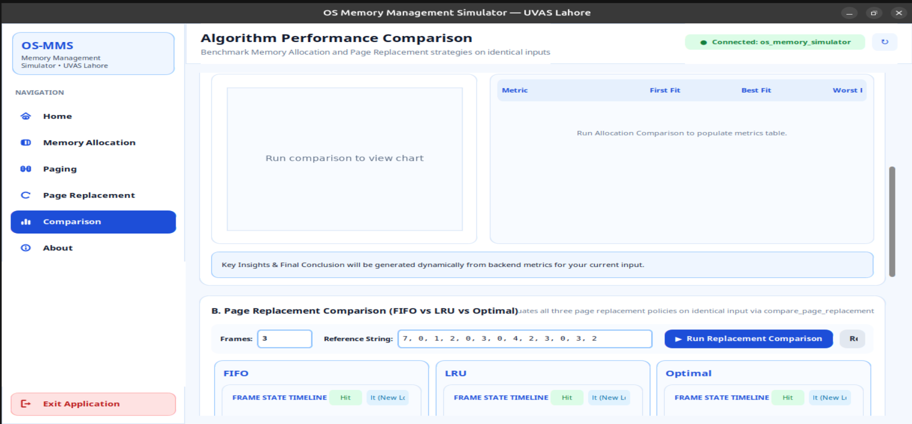
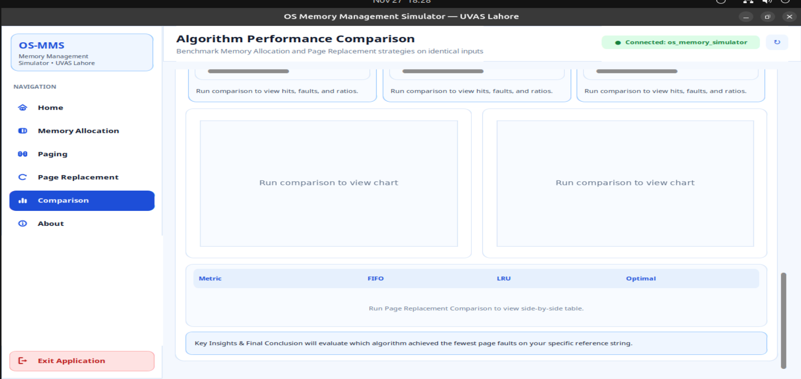
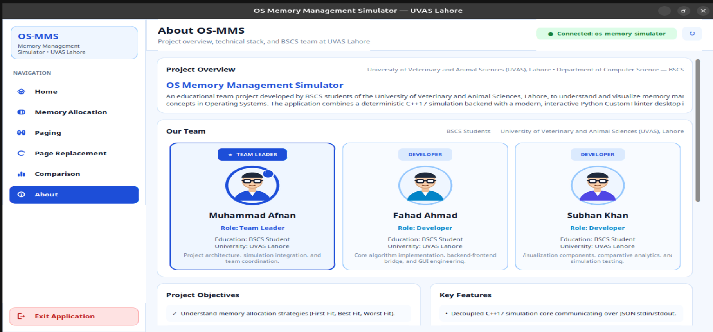
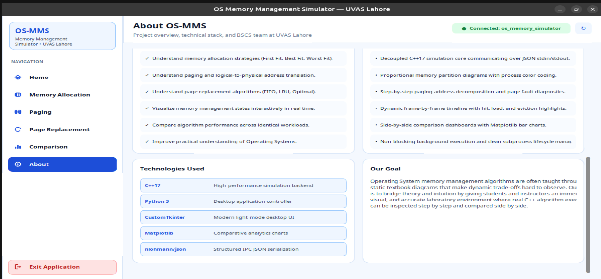

# 🖥️ OS Memory Management Simulator

<p align="center">
  <strong>A GUI-Based Operating Systems Group Project</strong>
  <br>
  Exploring Memory Allocation, Paging, Address Translation & Page Replacement
</p>

<p align="center">
  
  
  
</p>

---

## 📖 About The Project

**OS Memory Management Simulator** is a collaborative university group project developed as part of the Operating Systems course.

The project focuses on understanding and visualizing fundamental memory management concepts used by modern operating systems. It provides a graphical environment where users can explore different memory allocation strategies, understand paging and address translation, and simulate various page replacement algorithms.

The application uses a **C++ backend** for algorithm execution and a **Python GUI built with CustomTkinter** for user interaction and visualization.

Through interactive simulations and visual representations, the application aims to make complex operating system concepts easier to understand and analyze.

## ✨ Features

- 🎨 Interactive and user-friendly Graphical User Interface (GUI).
- 🧠 Multiple contiguous memory allocation strategies.
- 📦 Visual representation of memory blocks and allocation.
- 🔄 Paging and logical-to-physical address translation.
- 📊 Interactive page replacement simulations.
- 📈 Page fault counting and performance analysis.
- ⚡ Comparison of different memory management algorithms.
- 🎯 Step-by-step visualization of algorithm execution.

## 🧩 Project Modules

### 1. Contiguous Memory Allocation

This module demonstrates how an operating system allocates memory to processes using different allocation strategies.

| Algorithm | Description |
|---|---|
| **First Fit** | Allocates the first available memory block that is large enough. |
| **Best Fit** | Allocates the smallest available block that can accommodate the process. |
| **Worst Fit** | Allocates the largest available memory block. |

**Implemented functionality:**

- Input memory block sizes.
- Input process sizes.
- Visualize memory allocation.
- Display allocated and unallocated processes.
- Show remaining memory in each block.

### 2. Paging & Address Translation

This module demonstrates paging, where logical memory is divided into pages and physical memory is divided into frames.

**Implemented functionality:**

- Logical address input.
- Page number calculation.
- Offset calculation.
- Page table visualization.
- Logical-to-physical address translation.
- Display translated physical addresses.

### 3. Page Replacement Algorithms

This module demonstrates how an operating system manages pages when available physical memory frames are full.

| Algorithm | Description |
|---|---|
| **FIFO** | Replaces the page that entered memory first. |
| **LRU** | Replaces the least recently used page. |
| **Optimal** | Replaces the page that will not be needed for the longest time in the future. |

**Implemented functionality:**

- Page reference string input.
- Frame allocation visualization.
- Step-by-step page replacement.
- Page hit and page fault detection.
- Total page fault calculation.
- Algorithm performance comparison.

## 🎨 Graphical User Interface

The project includes a graphical interface designed to provide an interactive learning experience.

**GUI sections:**

- Main Dashboard
- Memory Allocation Simulator
- Paging Simulator
- Address Translation
- Page Replacement Simulator
- Algorithm Comparison
- Results and Statistics
- About & Team

The GUI allows users to provide inputs, execute simulations, and observe how each algorithm manages memory.

## 🗂️ Project Structure

The project is organized into two main components: a C++ backend and a Python frontend.

```text
OS/
│
├── README.md
├── .gitignore
│
├── backend/
│   ├── CMakeLists.txt
│   │
│   ├── include/
│   │   ├── common/
│   │   │   └── json_handler.h
│   │   │
│   │   ├── comparison/
│   │   │   ├── allocation_comparison.h
│   │   │   └── page_replacement_comparison.h
│   │   │
│   │   ├── page_replacement/
│   │   │   ├── fifo.h
│   │   │   ├── lru.h
│   │   │   └── optimal.h
│   │   │
│   │   └── paging/
│   │       └── paging.h
│   │
│   ├── src/
│   │   ├── allocation/
│   │   │   ├── first_fit.cpp
│   │   │   ├── best_fit.cpp
│   │   │   └── worst_fit.cpp
│   │   │
│   │   ├── common/
│   │   │   └── json_handler.cpp
│   │   │
│   │   ├── comparison/
│   │   │   ├── allocation_comparison.cpp
│   │   │   └── page_replacement_comparison.cpp
│   │   │
│   │   ├── page_replacement/
│   │   │   ├── fifo.cpp
│   │   │   ├── lru.cpp
│   │   │   └── optimal.cpp
│   │   │
│   │   ├── paging/
│   │   │   └── paging.cpp
│   │   │
│   │   └── main.cpp
│   │
│   └── build/                 
│
└── frontend/
    ├── assets/
    │   └── icons/
    │       ├── generator.py
    │       ├── Dashboard1.png
    │       ├── Dashboard2.png
    │       ├── Memory_Allocation1.png
    │       ├── Memory_Allocation2.png
    │       ├── Pagging1.png
    │       ├── Pagging2.png
    │       ├── Page_Replacement1.png
    │       ├── Page_Replacement2.png
    │       ├── Comparison1.png
    │       ├── Comparison2.png
    │       ├── Comparison3.png
    │       ├── about1.png
    │       └── about12.png
    │
    ├── components/
    │   ├── __init__.py
    │   ├── buttons.py
    │   ├── cards.py
    │   ├── charts.py
    │   ├── header.py
    │   ├── memory_visualization.py
    │   ├── page_frame_visualization.py
    │   ├── paging_visualization.py
    │   └── sidebar.py
    │
    ├── pages/
    │   ├── __init__.py
    │   ├── about.py
    │   ├── comparison.py
    │   ├── home.py
    │   ├── memory_allocation.py
    │   ├── page_replacement.py
    │   └── paging.py
    │
    ├── backend_bridge.py
    ├── config.py
    ├── main.py
    ├── requirements.txt
    └── venv/                  
```

**Note:** The `build/`, `venv/`, and `__pycache__/` directories are generated locally and are excluded from Git using `.gitignore`.

## 🛠️ Technologies Used

| Technology | Purpose |
|---|---|
| C++ | Backend algorithm implementation |
| Python | Frontend application |
| CustomTkinter | Graphical user interface |
| CMake | C++ build system |
| JSON | Backend and frontend communication |
| Git | Version control |
| GitHub | Team collaboration and source code management |

## 🚀 Getting Started

Follow these steps to download the project and run it on your local machine.

### Prerequisites

Before running the project, make sure you have:

- Git installed.
- Python 3 installed.
- C++ compiler (G++) installed.
- CMake installed.
- Required Python dependencies.

### 1. Clone the Repository

Open your terminal or CMD and execute:

```bash
git clone https://github.com/FahadAhmad06/OS-Memory-Management-Simulator.git
```

### 2. Navigate to the Project Directory

```bash
cd OS-Memory-Management-Simulator
```

### 3. Open in VS Code

```bash
code .
```

### 4. Build the C++ Backend

```bash
cd backend
cmake -S . -B build
cmake --build build
```

### 5. Set Up the Python Frontend

```bash
cd ../frontend
python3 -m venv venv
source venv/bin/activate
pip install -r requirements.txt
```

### 6. Run the Application

```bash
python3 main.py
```

**Note:** Make sure the backend executable path is correctly configured in `frontend/config.py` and `frontend/backend_bridge.py`.

## 📸 Screenshots & Preview

Screenshots of the actual application interface and its simulations.

### 🏠 Main Dashboard

<p align="center">
  
  
</p>

### 🧱 Memory Allocation

<p align="center">
  
  
</p>

### 🔄 Paging & Address Translation

<p align="center">
  
  
</p>

### 📑 Page Replacement

<p align="center">
  
  
</p>

### 📊 Algorithm Comparison

<p align="center">
  
  
  
</p>

### ℹ️ About & Team

<p align="center">
  
  
</p>

## 📊 Performance Analysis

The simulator provides a practical comparison of the implemented algorithms.

**Memory Allocation Analysis**

- Memory block utilization.
- Process allocation results.
- Remaining memory.
- Allocation success and failure.

**Page Replacement Analysis**

- Total page faults.
- Total page hits.
- Page fault ratio.
- Performance comparison between FIFO, LRU, and Optimal.

## 👥 Project Team

This project is collaboratively developed by our group as part of the Operating Systems coursework.

| No. | Team Member | GitHub Profile |
|---|---|---|
| 1 | Fahad Ahmad | [@FahadAhmad06](https://github.com/FahadAhmad06) |
| 2 | Muhammad Afnan | [@muhammadAfnan2005](https://github.com/muhammadAfnan2005) |
| 3 | Subhan Khan | [@subhankahn-it](https://github.com/subhankahn-it) |

## 🤝 Team Collaboration

We use GitHub to manage the project and coordinate development among group members.

- Each member works on assigned project modules.
- Separate branches are used for individual contributions.
- Pull requests are used to review and merge changes.
- The main branch maintains the integrated project code.

## 🎯 Project Objectives

- Understand operating system memory management.
- Explore contiguous memory allocation techniques.
- Learn paging and address translation.
- Understand different page replacement strategies.
- Visualize how memory is allocated and managed.
- Analyze and compare algorithm performance.
- Apply theoretical Operating Systems concepts through practical implementation.

## 🔮 Future Enhancements

- Improved interactive memory visualization.
- Step-by-step algorithm execution controls.
- Advanced performance comparison charts.
- Enhanced GUI design and user experience.
- Additional memory management techniques.

## 🎓 Academic Information

| Detail | Information |
|---|---|
| Institution | University of Veterinary and Animal Sciences (UVAS), Lahore |
| Course | Operating Systems |
| Project Title | OS Memory Management Simulator |
| Project Type | Group Project |
| Domain | Operating Systems / Memory Management |

## 📄 License

This project is developed for educational and academic purposes as part of our university coursework.

---

<p align="center">
  <strong>OS Memory Management Simulator</strong>
  <br>
  Developed with teamwork, learning, and collaboration. 💻
  <br><br>
  ⭐ If you find this project interesting, consider giving the repository a star!
</p>
